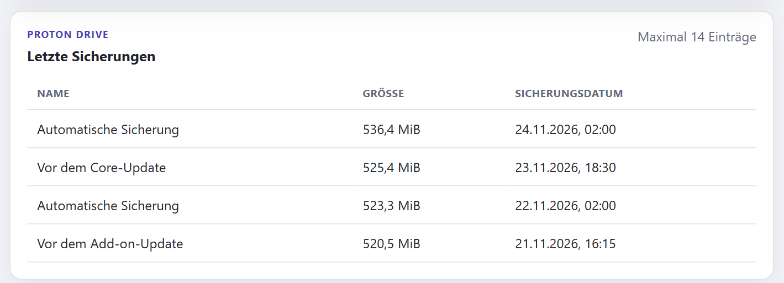
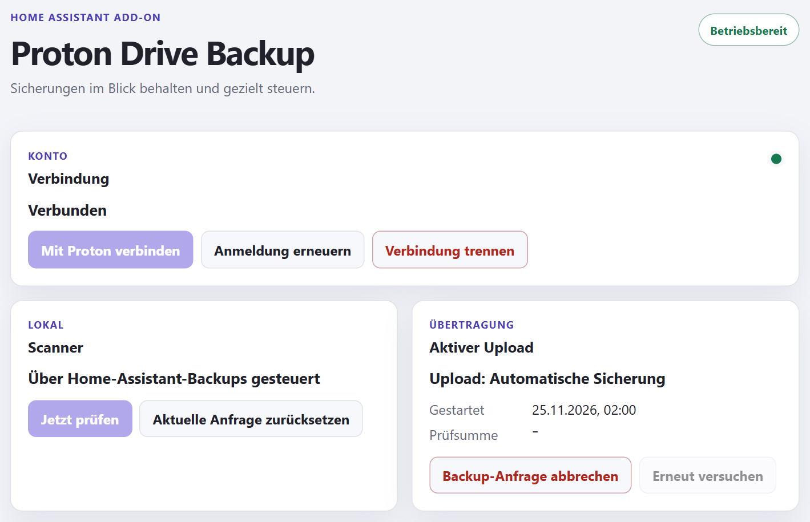

# Proton Drive als Sicherungsort für Home Assistant

Sichere dein Home Assistant nach **Proton Drive**, ohne für jede Sicherung die App öffnen zu müssen. Diese Integration ergänzt das gewohnte Backup-Menü: Dort bestimmst du Inhalt, Zeitplan und Verschlüsselung. Die [Begleit-App](https://github.com/Fighterbomber001/Proton-drive-4-Homeassistant-App) übernimmt die Proton-Anmeldung und überträgt das Archiv.

[Einrichtung im Handbuch](HANDBUCH.md#installation-und-kopplung) · [App für Home Assistant OS](https://github.com/Fighterbomber001/Proton-drive-4-Homeassistant-App) · [Wiederherstellung](HANDBUCH.md#download-und-wiederherstellung-erproben)

## So sieht eine bestätigte Sicherung aus

Die Beispiele zeigen das Dashboard der **Begleit-App** mit erfundenen Sicherungsnamen, Größen und Zeiten. Es werden keine privaten Daten angezeigt.

**So liest du die Übersicht:** Das Datum der letzten bestätigten Sicherung entspricht dem neuesten Eintrag in der Tabelle. Die App zeigt bis zu 14 Einträge. Das ist kein Aufbewahrungslimit: Ältere Proton-Kopien werden deswegen nicht automatisch gelöscht.

Wie sieht eine laufende Übertragung aus?

Ein aktiver Upload und die Zahl der **wartenden** Uploads sind getrennte Angaben. Auch bei einer leeren Warteschlange kann gerade ein Archiv übertragen werden.

## Einrichtung

**Voraussetzungen:** Home Assistant OS auf amd64 (x86-64), Home Assistant Core ab 2026.11.2 und ein Proton-Konto mit ausreichend freiem Speicher.

1. Installiere die [Begleit-App](https://github.com/Fighterbomber001/Proton-drive-4-Homeassistant-App) unter **Einstellungen → Apps**. Aktiviere ihre native Backup-Anbindung, richte den lokalen Kopplungsschlüssel ein und melde dich in der App bei Proton an.
2. Füge dieses Repository unter **Einstellungen → Marketplace → Aus Link hinzufügen** hinzu. Installiere die Integration und folge gegebenenfalls der Aufforderung zum Core-Neustart.
3. Wähle **Einstellungen → Geräte & Dienste → Integration hinzufügen → Proton Drive**. Trage die interne App-Adresse und denselben lokalen Kopplungsschlüssel ein.
4. Wähle unter **Einstellungen → System → Backups** den zusätzlichen Sicherungsort **Proton Drive**. Teste eine kleine manuelle Sicherung und lade sie von diesem Ziel wieder herunter.

**Für den Notfall:** Bewahre den Home-Assistant-Notfallschlüssel getrennt auf und behalte einen weiteren Sicherungsort. Ein bestätigter Upload ersetzt keine erprobte Wiederherstellung.

[Handbuch](HANDBUCH.md) · [Sicherheit](SECURITY.md) · [Disclaimer](DISCLAIMER.md)

Dies ist ein unabhängiges Community-Projekt, kein offizielles Produkt von Proton oder Home Assistant. „Proton“ und „Proton Drive“ sind Marken der Proton AG; siehe [Protons Nutzungsbedingungen](https://proton.me/legal/terms), Abschnitt 8. Die Proton-CLI wird von der separaten App beim Erstellen ihres Images von Proton bezogen und ist nicht Teil des Repository-Quellcodes.
